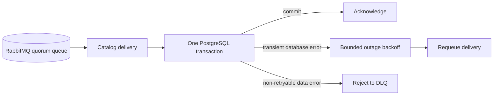

# Database resilience

`musicbrainz-sql-loader` uses the pinned `groovemap-runtime` PostgreSQL and RabbitMQ
adapters. The service is designed to pause safely during a transient database outage and
resume from durable broker state. The shared connection, retry, circuit-breaker, and
telemetry mechanics are defined by the
[`groovemap-runtime` boundary](https://github.com/groovemap-music/python-libraries/blob/main/docs/runtime.md);
this page records only how this loader applies them.

## PostgreSQL

The async pool defaults to 2–12 connections. Each entity consumer's AMQP delivery limit
equals the configured pool maximum, while a single `WriteAdmission` budget shared by all
four entity handlers and same-pool reconciliation keeps actual database writers within
that maximum. Per-consumer limits alone allow aggregate deliveries across queues to exceed
the pool size; the shared admission budget provides the aggregate bound. Each catalog
record uses one bounded transaction, and relationship and external link children use
`executemany` to reduce round trips.

The budget is created once per service loop after the PostgreSQL pool initializes and
before RabbitMQ consumers register. It comes from `groovemap-runtime` commit
`fb4577ecef1090d29ad3ea9f6d2a5e9e8edf90d7`, pinned in `pyproject.toml` and `uv.lock`.
At this handoff, that reviewed commit exists in the local `python-libraries` checkout but
has not been pushed or published. Until that changes, local full checks and wheel staging
must set `GROOVEMAP_RUNTIME_REPO` to that checkout; the dependency metadata keeps the
canonical GitHub URL and immutable revision.
The service's default `just check` remains offline. `just test-admission-integration`
starts exclusively named disposable RabbitMQ and PostgreSQL containers, disables global
QoS in RabbitMQ, and exercises the real consumer callback, bounded database activity,
cancellation, broker redelivery, and recovery. It does not accept caller-supplied service
URLs.

`InterfaceError`, `OperationalError`, and `DatabaseUnavailableError` are transient. The
loader waits before requeueing so a maintenance window cannot rapidly consume the quorum
queue's finite delivery limit. Deterministic `DataError` and `IntegrityError` failures are
rejected without retry and arrive in the dead-letter queue.

## RabbitMQ and restart

The broker connection uses heartbeat monitoring and bounded reconnect attempts. Exchanges,
quorum live queues, dead-letter exchanges, and classic dead-letter queues are durable, matching
every sibling catalog service. Live-queue bounding comes from `x-delivery-limit` plus the
fleet's quorum-queue policy; DLQ bounding is a broker policy tracked separately
(`gm-deployment-8mb`), not a queue-type change here — RabbitMQ cannot change an existing
queue's type in place. Graceful process shutdown cancels subscriptions before closing the
connection so unsettled records are redelivered once rather than churned. See
[Release-group starvation incident](musicbrainz-sync.md#release-group-starvation-incident)
for the consumer-loss diagnosis and the operator bead tracking the DLQ policy and the
parked-message decision.

## Health

Port `8002` (`HEALTH_PORT`) reports `starting` before the PostgreSQL pool exists, `unhealthy` for a
detected stuck state, and `healthy` once the pool is available and consumer state is
consistent. Connection strings and credentials are never returned or logged.

For capacity rationale and the prior pool-exhaustion diagnosis, see
[PostgreSQL connection-budget analysis](postgres-pool-exhaustion-analysis.md).
Current fleet connection budgets and deployment-time overrides are owned by the
[`deployment` configuration](https://github.com/groovemap-music/deployment/blob/main/docs/configuration.md#database-connections).
