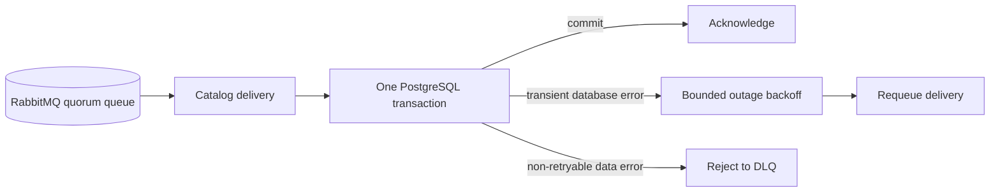

# Database resilience

`musicbrainz-sql-loader` uses the pinned `groovemap-runtime` PostgreSQL and RabbitMQ
adapters. The service is designed to pause safely during a transient database outage and
resume from durable broker state. The shared connection, retry, circuit-breaker, and
telemetry mechanics are defined by the
[`groovemap-runtime` boundary](https://github.com/groovemap-music/python-libraries/blob/main/docs/runtime.md);
this page records only how this loader applies them.

## PostgreSQL

The async pool defaults to 2–12 connections. Each entity consumer's AMQP delivery limit
equals the configured pool maximum, while one shared `WriteAdmission` budget caps actual
database writers across all four entity handlers and same-pool reconciliation. Each
catalog record uses one bounded transaction, and relationship and external-link children
use `executemany` to reduce round trips.

The budget is created once per service lifespan after the pool initializes and before
RabbitMQ consumers register. Consumer recovery keeps the same instance. Shutdown waits for
confirmed consumer cancellation and broker closure, then drains callbacks and SQL scopes
before closing the pool and clearing the budget. Uncertain cleanup retains both and refuses
a replacement lifespan; an explicit cleanup retry may clear them after closure and drain
are confirmed. The published runtime pin `264e1d84c7165525844d3b1210179cfbf72a61f2`
exposed `DeliveryAdmission`. It was renamed to canonical `WriteAdmission` at
`40d799c6ae0cd9b11b524f7477642a5c14f5f8f2`, then gained callback and SQL-scope drain
support at `a86f3e48783a8618be62667c74258eaa30388494`; both producer commits are reviewed
in [python-libraries PR #21](https://github.com/groovemap-music/python-libraries/pull/21).
The `40d799c` consumer draft was never published. This additive consumer reconciliation
builds on earlier local reviewed reference `68851ad31defbe2d24fca28d2354f3b269ea486b`;
the published loader commits, msgpack 1.2.3 security fix, and producer-owned contract
artifacts remain intact.

The default checks remain service-free. `just test-admission-integration`, which `just
test-integration` and so CI run, starts only task-owned disposable RabbitMQ and PostgreSQL containers, disables global QoS in RabbitMQ,
and exercises the real callback, bounded database activity, cancellation, redelivery, and
`_recover_consumers` path. It does not accept caller-supplied service URLs.

`InterfaceError`, `OperationalError` (other than SQLSTATE class 54), and
`DatabaseUnavailableError` are transient, and so is an unknown exception or a failed
delete-reconciliation. The loader waits before every requeue, 2 s doubling to 60 s, because
nothing else paces one: RabbitMQ 4.3.5 and 4.4.0 do not spend `x-delivery-limit` on
`nack(requeue=True)`, so a nacked message comes straight back and never dead-letters. Once the
broker's `x-acquired-count` reaches `MAX_REQUEUES` (500) the message is logged at critical level
and rejected to the DLQ instead. That lets a failure of about 8.2 hours pass with no record lost,
provided only nacks return it: a channel or connection close does spend `x-delivery-limit`, so 20
restarts during one outage dead-letter a message early, with reason `delivery_limit`. A persistent
failure ends within 500 × (60 s + one attempt), and a message failing while other records succeed
ends far sooner, because a success resets the backoff. A dead-lettered `extraction_complete`
is a dead letter like any other, so it vetoes the delete-reconciliation until it is replayed or
cleared. This is deliberate and matches `discogs-sql-loader`: no DLQ is scanned for message types,
and the consecutive-veto alert below makes the case loud. Replaying it after a restart needs the
other signals again, because the collected signals are process memory; otherwise clear it, and the
next extraction reconciles. Deterministic
`DataError` and `IntegrityError` failures are rejected without retry and arrive in the
dead-letter queue. So are `OperationalError`s in SQLSTATE class 54 (`ProgramLimitExceeded`,
for example an index row larger than the btree maximum): the record itself is the cause, so
retrying would requeue the same message indefinitely and stall its consumer. The shared
`is_permanent_operational_error` in `groovemap-runtime` defines that allow-list.

## Purge vetoes

When the fourth signal latches, the delete-reconciliation is vetoed if any entity's `.dlq` holds a
dead letter, if the broker cannot be read, if this run rejected a record, or if an earlier delivery
of this extraction recorded a veto. So a veto survives a restart and covers dead letters the broker
made itself. Every extraction that reaches this point writes one `loader = 'musicbrainz'` row to
`loader_extraction_latch`, keyed by the signal's version, with the vetoing types in `purge_vetoed`.
Writing it is part of the decision: if it fails, the signal is requeued.

A dead letter keeps vetoing until someone deals with it, and stale rows stay until then. Deal with it
only after that run's signals have settled. Replay the records once the cause is fixed: no GrooveMap
tool does this, so use a shovel from the `.dlq` to the live queue, or the RabbitMQ management UI's
move-messages action, and enable the `rabbitmq_shovel` plugins first because the deployment does not.
Or purge the DLQ from the operations console (`POST /admin/api/dlq/purge/{queue}`) if the records are
not wanted. The next extraction then reconciles.

**`Delete-reconciliation vetoed on consecutive extractions`.** The gauge
`groovemap.pipeline.purge.consecutive_vetoes` counts the extractions in a row that vetoed the purge,
from `purge_vetoed`, so it survives restarts and is read again at startup. From 2 the loader logs this
line at error level. It means a dead letter has stayed for two dumps, or a record is rejected in every
dump. The veto is right to hold, because it protects live rows: read the `.dlq`, fix the cause and
replay, or clear it. One veto followed by a clean purge does not reach the threshold. Until a Grafana
rule covers this loader, this error line is the alert, and nothing pages.

In `RELOAD_MODE=seen`, a seen list that is not intact for the extraction is a veto too. PostgreSQL
crash recovery empties the unlogged lists together with their registry, and a list restarted after the
extraction began misses its first keys, so neither can say what the extraction saw. The purge is
skipped and the list's name (`loader_seen.musicbrainz_relationships` or
`loader_seen.musicbrainz_external_links`) is added to `purge_vetoed`, so the consecutive-veto alert
counts it. The lists are restarted, and the next extraction purges normally. Nothing needs replaying.

This loader needs the `purge_vetoed` column. Ship the `database-schema` release carrying it first. In
the wrong order nothing is lost: the delete-reconciliation stays off and loading continues.

## RabbitMQ and restart

The broker connection uses heartbeat monitoring and bounded reconnect attempts. Exchanges,
quorum live queues, dead-letter exchanges, and classic dead-letter queues are durable, matching
every sibling catalog service. `x-delivery-limit` bounds returns from closed channels and
connections, not nacks or consumer timeouts, plus the fleet's quorum-queue policy; DLQ bounding is a broker policy tracked separately
(`gm-deployment-8mb`), not a queue-type change here — RabbitMQ cannot change an existing
queue's type in place. Graceful process shutdown cancels subscriptions before closing the
connection so unsettled records are redelivered once rather than churned. See
[Release-group starvation incident](musicbrainz-sync.md#release-group-starvation-incident)
for the consumer-loss diagnosis and the operator bead tracking the DLQ policy and the
parked-message decision.

## Health

Port `8002` (`HEALTH_PORT`) reports `starting` before the PostgreSQL pool exists, `unhealthy` for a
detected stuck state, and `healthy` once the pool is available and consumer state is
consistent. Connection strings and credentials are never returned or logged.

For capacity rationale and the prior pool-exhaustion diagnosis, see
[PostgreSQL connection-budget analysis](postgres-pool-exhaustion-analysis.md).
Current fleet connection budgets and deployment-time overrides are owned by the
[`deployment` configuration](https://github.com/groovemap-music/deployment/blob/main/docs/configuration.md#database-connections).
