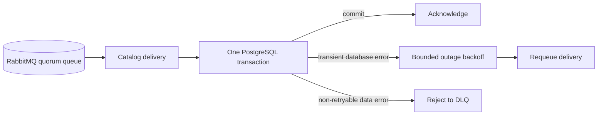

# Database resilience

`musicbrainz-sql-loader` uses the pinned `groovemap-runtime` PostgreSQL and RabbitMQ
adapters. The service is designed to pause safely during a transient database outage and
resume from durable broker state. The shared connection, retry, circuit-breaker, and
telemetry mechanics are defined by the
[`groovemap-runtime` boundary](https://github.com/groovemap-music/python-libraries/blob/main/docs/runtime.md);
this page records only how this loader applies them.

## PostgreSQL

The async pool defaults to 2–12 connections. Each entity consumer's AMQP delivery limit
equals the configured pool maximum, while one shared `WriteAdmission` budget caps actual
database writers across all four entity handlers and same-pool reconciliation. Each
catalog record uses one bounded transaction, and relationship and external-link children
use `executemany` to reduce round trips.

The budget is created once per service lifespan after the pool initializes and before
RabbitMQ consumers register. Consumer recovery keeps the same instance. Shutdown waits for
confirmed consumer cancellation and broker closure, then drains callbacks and SQL scopes
before closing the pool and clearing the budget. Uncertain cleanup retains both and refuses
a replacement lifespan; an explicit cleanup retry may clear them after closure and drain
are confirmed. The published runtime pin `264e1d84c7165525844d3b1210179cfbf72a61f2`
exposed `DeliveryAdmission`. It was renamed to canonical `WriteAdmission` at
`40d799c6ae0cd9b11b524f7477642a5c14f5f8f2`, then gained callback and SQL-scope drain
support at `a86f3e48783a8618be62667c74258eaa30388494`; both producer commits are reviewed
in [python-libraries PR #21](https://github.com/groovemap-music/python-libraries/pull/21).
The `40d799c` consumer draft was never published. This additive consumer reconciliation
builds on earlier local reviewed reference `68851ad31defbe2d24fca28d2354f3b269ea486b`;
the published loader commits, msgpack 1.2.3 security fix, and producer-owned contract
artifacts remain intact.

The default checks remain service-free. `just test-admission-integration` starts only
task-owned disposable RabbitMQ and PostgreSQL containers, disables global QoS in RabbitMQ,
and exercises the real callback, bounded database activity, cancellation, redelivery, and
`_recover_consumers` path. It does not accept caller-supplied service URLs.

`InterfaceError`, `OperationalError`, and `DatabaseUnavailableError` are transient. The
loader waits before requeueing so a maintenance window cannot rapidly consume the quorum
queue's finite delivery limit. Deterministic `DataError` and `IntegrityError` failures are
rejected without retry and arrive in the dead-letter queue.

## RabbitMQ and restart

The broker connection uses heartbeat monitoring and bounded reconnect attempts. Exchanges,
quorum live queues, dead-letter exchanges, and classic dead-letter queues are durable, matching
every sibling catalog service. Live-queue bounding comes from `x-delivery-limit` plus the
fleet's quorum-queue policy; DLQ bounding is a broker policy tracked separately
(`gm-deployment-8mb`), not a queue-type change here — RabbitMQ cannot change an existing
queue's type in place. Graceful process shutdown cancels subscriptions before closing the
connection so unsettled records are redelivered once rather than churned. See
[Release-group starvation incident](musicbrainz-sync.md#release-group-starvation-incident)
for the consumer-loss diagnosis and the operator bead tracking the DLQ policy and the
parked-message decision.

## Health

Port `8002` (`HEALTH_PORT`) reports `starting` before the PostgreSQL pool exists, `unhealthy` for a
detected stuck state, and `healthy` once the pool is available and consumer state is
consistent. Connection strings and credentials are never returned or logged.

For capacity rationale and the prior pool-exhaustion diagnosis, see
[PostgreSQL connection-budget analysis](postgres-pool-exhaustion-analysis.md).
Current fleet connection budgets and deployment-time overrides are owned by the
[`deployment` configuration](https://github.com/groovemap-music/deployment/blob/main/docs/configuration.md#database-connections).
